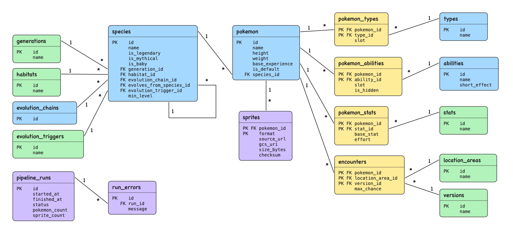

# Schema design

## Tables

| Group | Tables | Primary key |
|---|---|---|
| Main | `species`, `pokemon` | PokéAPI id |
| Lookups (mostly `id`, `name`) | `generations`, `habitats`, `evolution_chains`, `evolution_triggers`, `types`, `abilities`, `stats`, `location_areas`, `versions` | PokéAPI id |
| Links | `pokemon_types`, `pokemon_abilities`, `pokemon_stats`, `encounters` | the ids together |
| Pipeline | `sprites`, `pipeline_runs`, `run_errors` | see diagram |

A species is the animal (Pikachu). A pokemon is one form of that animal.

Two sprite files are saved per Pokémon: the PNG `front_default` and the GIF `showdown.front_default`.

Not stored, because they are out of scope: moves, items, damage relations, other sprites.

## Design requirements

1. **Third normal form.** Every name is stored once. "grass" is only in `types`; other tables store its id, `12`. No column holds a list: each list in the API became rows in its own table.
2. **Many-to-many.** A Pokémon has many types and a type has many Pokémon, so a link table sits between them. Facts about the pair (`slot`, `is_hidden`, `base_stat`, `effort`) are stored on the link table.
3. **Keys.** Every table has a primary key. Every line in the diagram is a foreign key.
4. **Re-runs.** Keys come from the API, so the same Pokémon always lands on the same row. Inserts use `ON CONFLICT ... DO UPDATE`, so a second run updates rows instead of adding copies.
5. **PokéAPI ids, not our own.** They are already in every response and URL, they are the same on every run, and rows are easy to compare with the API. Only `pipeline_runs` and `run_errors` generate ids, because the API has none for them.

## Review questions

**1. Where do slot and hidden live?**

On the link tables: `pokemon_types.slot`, `pokemon_abilities.slot` and `pokemon_abilities.is_hidden`. Slot is the position in the Pokémon's list (Bulbasaur: grass 1, poison 2). They describe the pair, not the ability: Lightning Rod is hidden for Pikachu but normal for Cubone.

**2. Pichu (#172) is outside the 50. What do we do?**

We load it as a `species` row, with no `pokemon` row. Pikachu's `evolves_from_species_id = 172` then points at a real row, so the foreign key stays valid. We do the same for every species in our chains that is outside the 50.

**3. How is a branch stored?**

Each species points at its parent with `evolves_from_species_id`. Vileplume and Bellossom both point at Gloom (44). Two rows with the same parent is the branch.

How it evolved is on the same row: `evolution_trigger_id` (level-up, use-item, trade) and `min_level`. Gloom has level-up and 21; Vileplume has use-item and no level. When the API lists several ways, we keep the first.

**4. How does each table avoid duplicates on a second run?**

| Tables | Conflict key |
|---|---|
| Main and lookups | `id` |
| Links | the ids together, for example `(pokemon_id, type_id)` |
| `sprites` | `(pokemon_id, format)` |

`pipeline_runs` and `run_errors` add new rows on every run on purpose: each run is a new event. A sprite file is not uploaded again when its checksum already matches.

**5. Which columns can be null?**

| Column | Why |
|---|---|
| `species.habitat_id` | the API has no habitat for some species |
| `species.evolves_from_species_id`, `evolution_trigger_id` | a base species (Oddish) has no parent |
| `species.min_level` | not every evolution has a level (Vileplume needs a stone) |
| `abilities.short_effect` | there may be no English text |
| `sprites.source_url`, `gcs_uri`, `size_bytes`, `checksum` | the sprite is missing or the upload failed |
| `pipeline_runs.finished_at` | the run is still going or crashed |

Everything else is `NOT NULL`.
